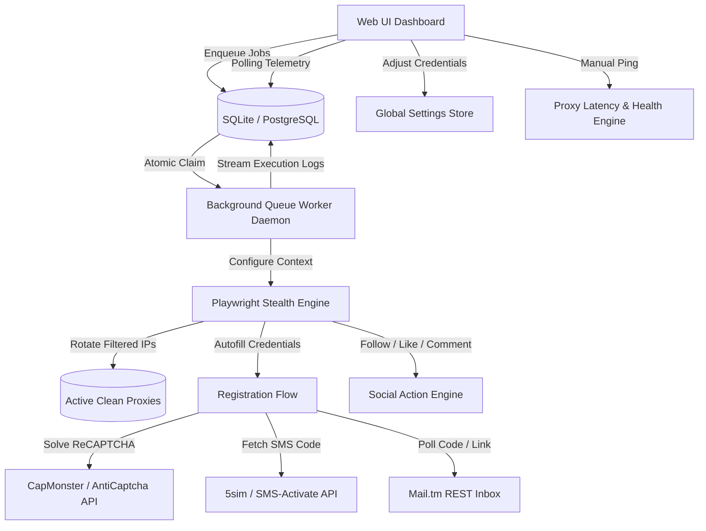

# Instagram SMM Panel

<p align="center">
  
  
  
  
  
</p>

An enterprise-grade, fully automated Instagram Social Media Marketing (SMM) Panel and bot management system. Engineered with **Django** and **Playwright**, the panel provides an interactive dashboard interface to orchestrate automated account registration, solve CAPTCHAs, verify SMS numbers, maintain live-monitored rotating proxy pools, and automate engagement actions (Follows, Likes, and Comments).

Features session cookie persistence, atomic queue processing, live console streaming, anti-bot detection evasion, and an Instagram-specific proxy health analyzer.

---

## 📖 Table of Contents
- [✨ Key Features](#-key-features)
- [🏗️ System Architecture](#️-system-architecture)
- [🛠️ Tech Stack](#️-tech-stack)
- [🚀 Quick Start Guide](#-quick-start-guide)
  - [Prerequisites](#prerequisites)
  - [Installation (Linux / macOS)](#installation-linux--macos)
  - [Installation (Windows)](#installation-windows)
  - [Automated Tests](#automated-tests)
- [⚙️ Configuration Parameters](#️-configuration-parameters)
- [🌐 Proxy Health & Handshake Ping System](#-proxy-health--handshake-ping-system)
- [📂 Project Structure](#-project-structure)
- [🔒 Security & Concurrency Design](#-security--concurrency-design)
- [📦 Production Deployment & Systemd](#-production-deployment--systemd)
- [🤝 Contributing](#-contributing)
- [⚖️ License](#️-license)

---

## ✨ Key Features

* **🖥️ Real-Time Telemetry Dashboard**: Monitor account health metrics, active rotating proxies, and task queue distributions with **Chart.js** data visualizations.
* **⚡ Atomic DB-Backed Queue Worker**: Multithreaded background queue with atomic task claiming (`UPDATE ... WHERE status='pending'`), completely preventing double-dispatch race conditions and SQLite database lockups.
* **🌐 Instagram Handshake Proxy Checker**: Live latency measurement and anti-ban classifier (`Clean / Fast`, `Slow Response`, `IG Blocked`, `Offline`). The queue worker automatically filters out blacklisted IPs to protect accounts.
* **🤖 Anti-Detection Stealth Engine**: Automated Chromium/Chrome engine with human-simulated typing speeds, randomized User-Agents, mobile device viewport emulation, and `navigator.webdriver = undefined` evasion.
* **📩 Resilient Email & SMS Verification**: Integrated with **Mail.tm** REST API with automatic fallback, dual extraction of verification links and 6-digit confirmation codes, paired with **5sim** / **SMS-Activate** phone dispatchers.
* **🍪 Session Cookie Persistence**: Caches browser storage states in `session_cookies/` to preserve sessions, eliminate repetitive logins, and bypass checkpoint intercepts.
* **📝 Live Stream Console**: Streams automated Playwright execution logs directly to an in-browser streaming terminal container.
* **📂 Bulk Data Management**: Import existing accounts in bulk via CSV or export your entire roster in a single click.

---

## 🏗️ System Architecture



---

## 🛠️ Tech Stack

* **Backend**: Django 5.x / Python 3.10 - 3.13+
* **Browser Automation**: Playwright Python (Chromium / Google Chrome with stealth flags)
* **HTTP & Scraping**: `requests`, `beautifulsoup4`
* **Database**: SQLite (Development) / PostgreSQL (Production)
* **Frontend UI**: Vanilla Responsive CSS (white-mode palette), Chart.js
* **Worker Execution**: Concurrent ThreadPool & Daemon Subprocess

---

## 🚀 Quick Start Guide

### Prerequisites
- Python 3.10, 3.11, 3.12, or 3.13
- SQLite3 (installed by default with Python)
- Google Chrome or Chromium (auto-detected or installed via Playwright)

### Installation (Linux / macOS)

1. **Clone the Repository**
   ```bash
   git clone https://github.com/pain-hub/instagram_smm_panel.git
   cd instagram_smm_panel
   ```

2. **Create and Activate a Virtual Environment**
   ```bash
   python3 -m venv venv
   source venv/bin/activate
   ```

3. **Install Dependencies**
   ```bash
   pip install -r requirements.txt
   ```

4. **Install Browser Engine (Optional if Google Chrome is installed)**
   ```bash
   playwright install chromium
   ```

5. **Apply Database Migrations**
   ```bash
   python manage.py makemigrations panel
   python manage.py migrate
   ```

6. **Start the Web Dashboard**
   ```bash
   python manage.py runserver 127.0.0.1:8000
   ```
   Open [http://127.0.0.1:8000](http://127.0.0.1:8000) in your browser.

7. **Launch the Dedicated Queue Worker (Optional Terminal)**
   ```bash
   python manage.py run_worker
   ```

### Installation (Windows)

```cmd
:: 1. Navigate to directory
cd Instagram_smm_panel

:: 2. Initialize Virtual Environment
python -m venv venv
venv\Scripts\activate

:: 3. Install packages
pip install -r requirements.txt

:: 4. Install Playwright binaries
playwright install chromium

:: 5. Initialize Database
python manage.py makemigrations panel
python manage.py migrate

:: 6. Launch Server
python manage.py runserver 127.0.0.1:8000
```

### Automated Tests

Verify that your environment, database, and browser launcher are operational:

```bash
python manage.py test
```

Expected output:
```text
System check identified no issues (0 silenced).
........
----------------------------------------------------------------------
Ran 8 tests in 3.973s

OK
```

---

## ⚙️ Configuration Parameters

Access the **Settings** view in the sidebar to configure runtime parameters:

| Category | Parameter | Default | Description |
| :--- | :--- | :--- | :--- |
| **Automation** | `Browser Engine` | `chromium` | **Chromium / Google Chrome (Recommended)**. High stability and anti-detection. |
| | `Local Browser Path` | *(Empty)* | Leave blank for auto-discovery (`/usr/bin/google-chrome`, system Chromium). |
| | `Headless Mode` | `True` | Run headless for background efficiency or `False` to watch automation live. |
| | `Delay Range` | `2` to `6` sec | Randomized delay range between keystrokes and button clicks. |
| **Email** | `Email Provider` | `mailtm` | **Mail.tm (Recommended)** or 1secmail. |
| **CAPTCHA** | `Solver Provider` | `capmonster` | Select CapMonster or AntiCaptcha. |
| | `API Secret Key` | *(Custom)* | Provider API key. |
| **SMS** | `SMS Provider` | `5sim` | Select 5sim or SMS-Activate. |
| | `API Auth Token` | *(Custom)* | Bearer authorization token for phone procurement. |
| **Proxies** | `Rotate Proxies` | `True` | Automatically rotate active clean proxies on each automation job. |

---

## 🌐 Proxy Health & Handshake Ping System

Instagram blocks datacenter IPs and unverified public proxies aggressively. The panel includes a dedicated handshake testing engine:

* **Live Latency Benchmark**: Tests each proxy against `https://www.instagram.com` with real mobile headers.
* **Auto-Classification**:
  - `🟢 Clean / Fast`: Latency < 2.5s, HTTP 200, no challenge prompts.
  - `🟡 Slow Response`: Response time >= 2.5s.
  - `🔴 IG Blocked`: Instagram HTTP 429 (Rate-limited), 403 (Forbidden), or IP challenge intercept.
  - `⚪ Offline`: Connection timed out or proxy tunnel refused.
* **Smart Filtering**: The task queue skips `Blocked` and `Offline` proxies automatically, ensuring tasks only execute over healthy IPs.
* **Single & Batch Testing**: Click **Ping** next to any proxy, or use **Ping & Verify All Proxies** for parallel multi-threaded testing.

---

## 📂 Project Structure

```bash
instagram_smm_panel/
├── smm_panel_project/               # Core Django configuration
│   ├── settings.py                  # Cookies hardening, SQLite timeout, CSP
│   ├── urls.py                      # Root URL routing
│   └── wsgi.py / asgi.py
│
├── panel/                           # SMM Panel Application
│   ├── models.py                    # Schema (Proxy, InstagramAccount, BotTask, GlobalSetting)
│   ├── views.py                     # View logic (Stats, CSV imports, Proxy checks, Logs API)
│   ├── forms.py                     # Form definitions with safe input validation
│   ├── urls.py                      # App routes
│   ├── worker.py                    # Background queue worker with atomic locking
│   ├── tests.py                     # Automated unit and integration test suite
│   │
│   ├── management/commands/
│   │   └── run_worker.py            # CLI daemon command (manage.py run_worker)
│   │
│   ├── templates/panel/             # Dashboard HTML Templates
│   │   ├── base.html                # Sidebar layouts and flash alerts
│   │   ├── dashboard.html           # Chart.js metrics
│   │   ├── accounts.html            # Profile grids & CSV bulk tools
│   │   ├── proxies.html             # Proxy health table, ping actions, scraper
│   │   ├── targets.html             # Engagement targets manager
│   │   ├── tasks.html               # Job submission dispatcher
│   │   ├── task_detail.html         # Live streaming console log
│   │   └── settings.html            # Dynamic credentials manager
│   │
│   └── bot_logic/                   # Automation Modules
│       ├── browser.py               # Playwright browser launcher with stealth & fallback
│       ├── human_behavior.py        # Keystroke typing simulation & randomized waits
│       ├── account_creator.py       # Registration sequence with code/link handling
│       ├── social_actions.py        # Follow, Like, and Comment controls
│       ├── proxy_scraper.py         # Scraping sslproxies.org & parallel health checker
│       ├── email_verifier.py        # Mail.tm REST inbox verification
│       ├── sms_handler.py           # 5sim / SMS-Activate API handler
│       ├── captcha_solver.py        # CapMonster ReCAPTCHA solver
│       └── helper.py                # Unique credentials helpers
│
├── static/css/
│   └── styles.css                   # Responsive white-mode theme styles
├── instruction.md                   # Complete local setup & troubleshooting guide
└── requirements.txt                 # Pinned dependencies
```

---

## 🔒 Security & Concurrency Design

* **Resource Leak Prevention**: All browser contexts, pages, and Playwright instances are closed inside nested `try...finally` scopes to prevent zombie browser processes.
* **Safe Session Management**: Session and CSRF cookies are set to `HttpOnly` with strict `SameSite=Lax` parameters to prevent token theft and clickjacking.
* **Prepared SQL Queries**: Leverages Django's ORM parameterization to eliminate SQL injection risks.
* **Atomic Queue Claiming**: Eliminates worker race conditions and table contention using atomic SQL updates.

---

## 📦 Production Deployment & Systemd

For production servers (Debian/Ubuntu/RHEL):

1. **Environment Setup**
   ```bash
   export DJANGO_DEBUG=False
   export DJANGO_SECRET_KEY="your-secure-random-secret-key"
   export ALLOWED_HOSTS="yourdomain.com,127.0.0.1"
   ```

2. **Web Server Service (`/etc/systemd/system/smm_web.service`)**
   ```ini
   [Unit]
   Description=Instagram SMM Panel Web Dashboard
   After=network.target

   [Service]
   User=www-data
   WorkingDirectory=/var/www/instagram_smm_panel
   ExecStart=/var/www/instagram_smm_panel/venv/bin/gunicorn smm_panel_project.wsgi:application --bind 127.0.0.1:8000 --workers 3
   Restart=always

   [Install]
   WantedBy=multi-user.target
   ```

3. **Background Worker Service (`/etc/systemd/system/smm_worker.service`)**
   ```ini
   [Unit]
   Description=Instagram SMM Panel Task Worker
   After=network.target

   [Service]
   User=www-data
   WorkingDirectory=/var/www/instagram_smm_panel
   ExecStart=/var/www/instagram_smm_panel/venv/bin/python manage.py run_worker
   Restart=always

   [Install]
   WantedBy=multi-user.target
   ```

4. **Enable and Start Services**
   ```bash
   sudo systemctl daemon-reload
   sudo systemctl enable --now smm_web smm_worker
   ```

---

## 🤝 Contributing

Contributions, bug reports, and suggestions are welcome!

1. Fork the Project.
2. Create your Feature Branch (`git checkout -b feature/NewFeature`).
3. Commit your Changes (`git commit -m 'Add NewFeature'`).
4. Push to the Branch (`git push origin feature/NewFeature`).
5. Open a Pull Request.

---

## ⚖️ License

Distributed under the MIT License. See `LICENSE` for more details.